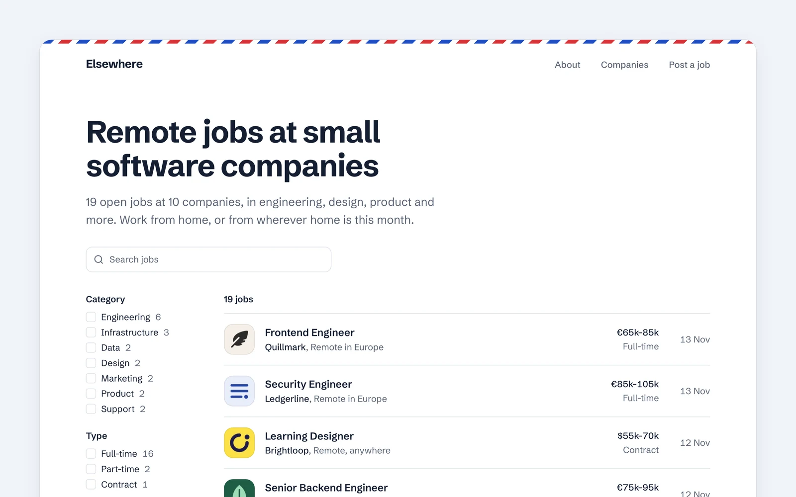

# Nohead job board starter



A job board built with [Next.js](https://nextjs.org) for content kept in [Nohead](https://nohead.io): jobs, the companies hiring and the categories they're in, with search and filters. Copy it, connect it to your own Nohead project, and replace the jobs with your own.

The demo is Elsewhere, a board for remote jobs at small software companies. The companies and jobs are invented.

## What it shows

- **Jobs** with a company, a category, a salary range, where the work happens, and a closing date; a job leaves the site the day after it closes, with nobody unpublishing it.
- **Companies** with a logo and a page listing their open jobs; **categories** with a page each.
- **Search and filters** on the home page, with Nohead's [public search](https://docs.nohead.io/guides/public-search) and [InstantSearch](https://www.algolia.com/doc/guides/building-search-ui/what-is-instantsearch/react/): type to search, and narrow the jobs by category, type, workplace, location and company, each choice showing how many jobs it leaves. Each hit carries its company's name and logo, so a result needs no other request. The search and filters are kept in the page's address (`/?q=design&type=Contract`), so Back from a job returns to them and a filtered list can be shared.
- **Applications from visitors:** a form on each job's page, sent by a server action that creates an unpublished record with a key of its own, which never leaves the server. Bots are kept out by a hidden field and, on Vercel, [Vercel BotID](https://vercel.com/docs/botid), which checks the visitor's browser without asking them anything.
- **Jobs posted by visitors, reviewed before they go live:** a [Post a job](app/post/page.tsx) page whose server action creates the job unpublished, with its company if it's new (logo uploaded to Nohead) and a posting saying who sent it. Someone reviews and publishes it in the web app ([below](#reviewing-posted-jobs)). The form's choices (type, workplace, currency) are read from the content model, so an option added in Nohead shows up in the form.
- **RSS feeds** of the open jobs, [`/feed.xml`](app/feed.xml/route.ts) and one per category (`/categories/<slug>/feed.xml`), for feed readers, and for email alerts: newsletter tools can email a feed's new items to their subscribers. Their links use `SITE_URL`, or on Vercel the production domain.
- **An about page**, [`/about`](app/about/page.tsx), linked from the header: what the board is and how it's made. It's written in code, as a board's own story is its own to tell: rewrite it for yours. Every page ends with a band saying the demo is made up, with links to this repository and Nohead ([`components/made-up.tsx`](components/made-up.tsx)): delete it for your own board.
- **A sitemap** of the open jobs, companies and categories, [`/sitemap.xml`](app/sitemap.ts), named in [`/robots.txt`](app/robots.ts), with links from `SITE_URL` as the feeds' are.
- **Share images** for the site and each job (its company's logo, title and terms), drawn with `next/og` in the site's typeface ([`lib/og.tsx`](lib/og.tsx)), and the site's icon. Pages point to them at the same address as the feeds' links.
- **Server rendering with Cache Components:** every page is prerendered and its content cached until it changes: at once when content is published, by a webhook, and at midnight (UTC), when jobs past their closing date leave.

The site reads its content from Nohead through one module, [`lib/content.ts`](lib/content.ts), that every page calls, and shows images through Nohead's image CDN, which resizes them ([`lib/image-loader.ts`](lib/image-loader.ts)).

## The content model

[`nohead.schema.yaml`](nohead.schema.yaml) is the Nohead project's content model as code: the jobs, the companies hiring and the categories the site shows, and the applications and postings visitors send, which stay unpublished. The [Nohead CLI](https://github.com/nohead-io/nohead-cli) pushes it to a project:

```bash
pnpm nohead login
pnpm nohead schema diff   # what would change
pnpm nohead schema push   # change it
```

`pnpm nohead schema pull` writes the project's model back to the file, after a change made in the web app.

## The demo content

[`scripts/seed.ts`](scripts/seed.ts) uploads the demo content in `seed/` to a project and publishes it: the categories, the companies with their logos, and the jobs. Push the schema first, then run it with an API key that has the `records:read`, `records:write` and `assets:write` scopes:

```bash
NOHEAD_API_KEY=... pnpm seed
```

It creates what's missing and leaves what's already there alone, matched by slug, so running it again is safe. The jobs' dates move forward together, so the newest was posted the day you seed.

## Keys

The site needs these from your Nohead project, set in `.env.local` (copy [`.env.example`](.env.example)):

- **`NOHEAD_API_KEY`**, an API key of its own: in the web app, under **API keys**, create one with **Published records only** on and the **Read records**, **Read assets** and **Read schema** scopes. The build needs it: every page is prerendered from the project's content, and the jobs' search index name is read with it.
- **`NOHEAD_SEARCH_TOKEN`**, a search token for the home page's search: create one on the project's **Search tokens** page. It is public: it goes in the page, and finds only the published jobs.
- **`NOHEAD_FORM_KEY`**, a second API key, for the forms: with only the **Write records** and **Upload assets** scopes, and **Published records only** off (such a key can't write). It can't read anything, and the server actions pick the fields they set, so a visitor can only send an application or post a job. What they send stays unpublished: the site's own key and the search token can't see it, while your team reads it in the web app.

```bash
NOHEAD_API_KEY=nohead_pk_...
NOHEAD_SEARCH_TOKEN=eyJ...
NOHEAD_FORM_KEY=nohead_sk_...
```

`NOHEAD_WEBHOOK_SECRET` comes from the webhook that refreshes the site ([below](#refreshing-when-content-is-published)).

Keeping bots out of the forms takes no key: a hidden field keeps out the simplest bots, and on Vercel, BotID checks the visitor's browser too ([below](#deploying-to-vercel)). The forms have no rate limit of their own: on a busy board, add one in front of them, such as your host's firewall rules.

## Deploying to Vercel

[](https://vercel.com/new/clone?repository-url=https%3A%2F%2Fgithub.com%2Fnohead-io%2Fstarter-jobs-nextjs&env=NOHEAD_API_KEY%2CNOHEAD_SEARCH_TOKEN%2CNOHEAD_FORM_KEY&envDescription=The%20site%20key%2C%20search%20token%20and%20form%20key%20from%20your%20Nohead%20project&envLink=https%3A%2F%2Fgithub.com%2Fnohead-io%2Fstarter-jobs-nextjs%23keys)

Push the schema and seed the project first ([above](#the-content-model)). The button copies this repository to your GitHub account and creates a Vercel project for it, asking for the [keys](#keys). The feeds, the sitemap and the share images use the project's production domain; `SITE_URL` sets another.

On Vercel, [BotID](https://vercel.com/docs/botid) checks the forms too ([`lib/bot-checks.ts`](lib/bot-checks.ts)), with nothing to set up: its Basic mode, free on every plan, stops simpler bots, and on the Pro plan its Deep Analysis, turned on in the project's **Firewall** settings, stops bots that drive a real browser.

## Refreshing when content is published

Every read from Nohead is cached under one tag, `nohead`, until midnight (UTC), when jobs past their closing date leave the board. A webhook clears it whenever published content changes, so an edit shows on the next visit, with no rebuild: [`app/webhooks/nohead/route.ts`](app/webhooks/nohead/route.ts) checks the request's signature and calls `revalidateTag`.

In the web app, under **Webhooks**, add one:

- **URL:** `https://<your site>/webhooks/nohead`
- **Events:** all of them (**All events**): with Published content only on, that's changes to published records and the assets they use, and to the content model, which the post form's choices are read from
- **Published content only:** on, so drafts and other unpublished changes don't clear the cache

Set its signing secret as `NOHEAD_WEBHOOK_SECRET`: on Vercel, in the project's **Settings → Environment Variables**, then redeploy.

Until the webhook is set up, an edit shows after midnight (UTC).

## Passing applications on

Applications arrive in your project's Applications collection, where your team reads them in the web app. To send each one on as it arrives, to the employer's inbox, a chat channel or an applicant tracking system, add a second webhook, for `record.created` events with **Published content only** off, pointing at a service of yours. It receives every record created, so it keeps the ones in the Applications collection and forwards them however suits you.

## Reviewing posted jobs

A job posted on the site is a draft until someone publishes it. In the web app, **Postings** lists each one with who sent it and how to reach them. Open its job (and its company, if the posting added a new one), check them, set the job's posted date to the day it goes live, and publish them; with the webhook above, the job is on the board at once. A posting stays unpublished, as an applicant's details do.

## Development

It needs Node 26 or newer and [pnpm](https://pnpm.io).

```bash
pnpm install
pnpm dev        # http://localhost:3000
pnpm build
pnpm check      # types
pnpm lint       # ESLint
pnpm format     # Prettier
```

## Credits

The typeface is [Schibsted Grotesk](https://fonts.google.com/specimen/Schibsted+Grotesk), under the SIL Open Font License. The interface uses [shadcn/ui](https://ui.shadcn.com) on [Base UI](https://base-ui.com), and icons from [Lucide](https://lucide.dev). The site's icon, a paper plane, is the "Send Email" icon from [Streamline](https://www.streamlinehq.com/icons)'s free Core set, under [CC BY 4.0](https://creativecommons.org/licenses/by/4.0/). The companies' logos are made for this demo, except Quillmark's feather, from Font Awesome: [`seed/images/README.md`](seed/images/README.md) credits it.

## License

[MIT](LICENSE). Quillmark's feather keeps its own license, listed in the credits.
